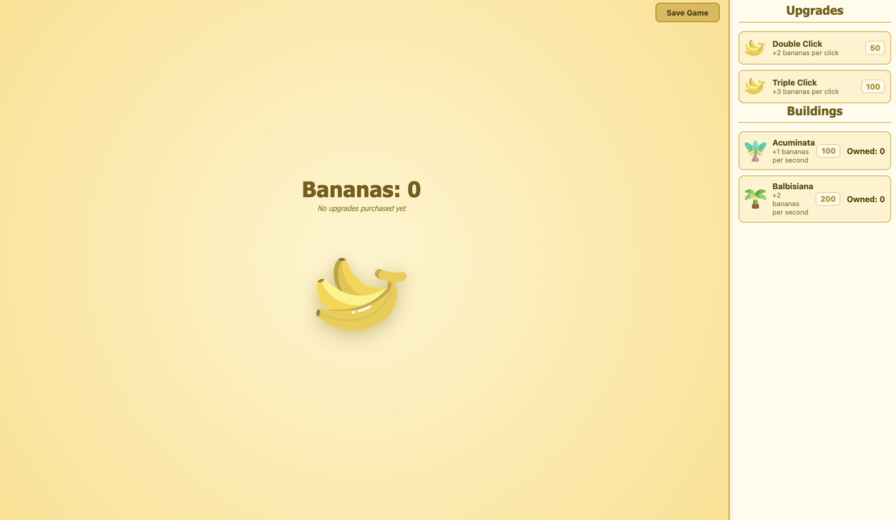

# Running

You can start my app using `npm` and `npx`:

```bash
npm install
npx vite
```

---

You can start my markov chain application using `node`:

```
node chain.ts
```

the matrix output can be seen in the `output-matrix.csv`.

# Other docs

* You can find my domain model in `domain.md`.
* You can find my flows of interaction in `flows.md`.
* You can fine my ui assessment in `ui-assessment.md`.

# Sources

* <https://stackoverflow.com/questions/79688441/typescript-enum-alternative-following-the-use-of-erasablesyntaxonly-flag>
* <https://vitest.dev/guide/>
* <https://www.geeksforgeeks.org/system-design/repository-design-pattern/>
* <https://stackoverflow.com/questions/13212625/typescript-function-overloading>
* <https://stackoverflow.com/questions/61900412/how-is-nodes-crypto-pbkdf2-supposed-to-work>
* <https://developer.mozilla.org/en-US/docs/Web/API/SubtleCrypto/digest>
* <https://stackoverflow.com/questions/30144580/typescript-multidimensional-array-initialization>
* <https://developer.mozilla.org/en-US/docs/Web/JavaScript/Guide/Regular_expressions>
* <https://stackoverflow.com/questions/929021/what-are-static-factory-methods?__cf_chl_tk=o.hku6tpi2mQC6dhW9CeyoJ8vz1vioGIeum4WXDhB9E-1786154501-1.0.1.1-ieOkTUd3YcKbZPxFvJwBhNXPNNUkA180AEXvhGapvos>
