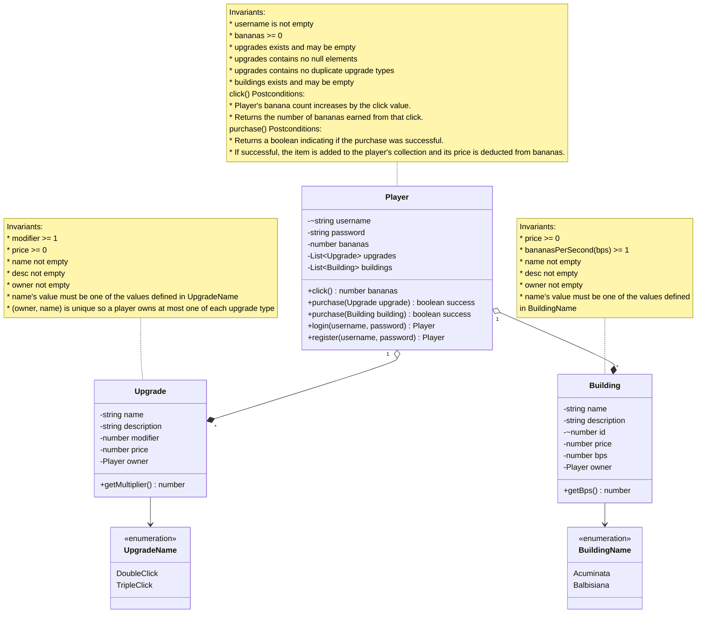

# Domain model

# Changes made since last submission
* removed specific upgrade and building types since they will be data in the `player` and `building` tables.
* removed interface keyword since upgrades and buildings will be instantiated objects.
* added an enum to simply denote the possible building and upgrade names since their values will be predefined.
* added relationship one to many for player and its upgrades/buildings.
* a building's quantity will now be the number of rows it is added in the table to avoid over complicating the table layout.
* added `owner` to `Upgrade` and `Building` to reflect the foreign key back to `Player`, getting rid of the need for additional tables.
* removed `~` from Building.name since building names are not unique across instances (a player can own multiple buildings of the same type).
