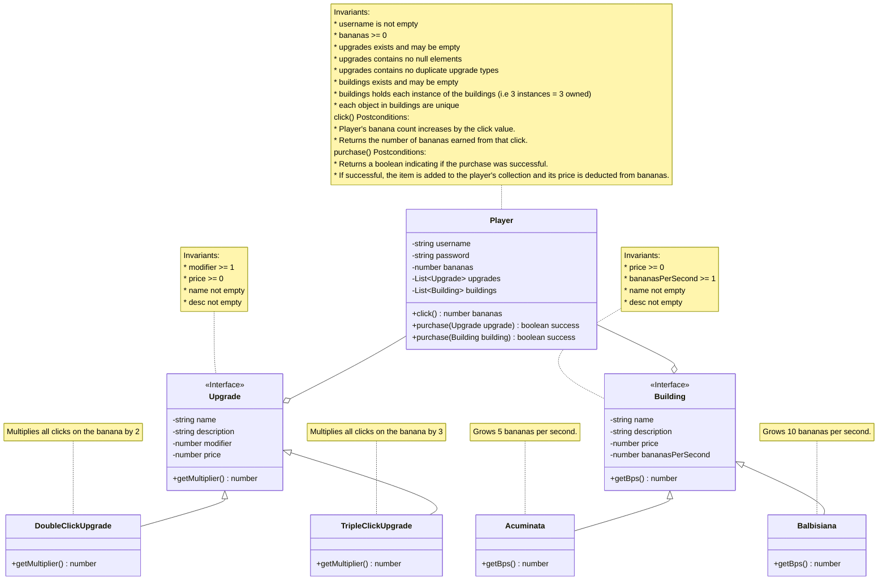

# Domain model

# Changes made

* Removed store object (YAGNI)
* Changed upgrades to inherit the upgrade type instead of being an enum.
* Since store is gone player now does the purchase behaviour.
* Added `Building` interface with `Acuminata`/`Balbisiana` implementations, kept as a separate hierarchy from `Upgrade` rather than a shared parent since buildings and upgrades are different (passive income vs. click modifiers).
* Added `username`  to `Player` to give each player a distinct identity.
* Added a second `purchase()` overload on `Player` for `Building`.
