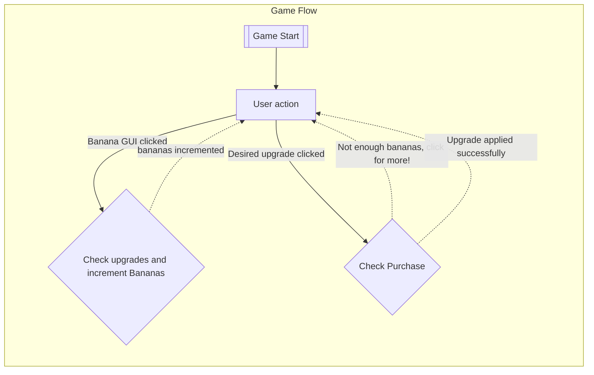

# Flows of interaction

This flows of interaction represents the main page of the game. Its assumed that the user can see all the buttons present on the page and that flows in this diagram do *not* represent transitions to a new page of the website.

Its also assumed that the game does not have a *end* or *exit* function at any point and that simply closing the webpage is the way of exiting the game.

