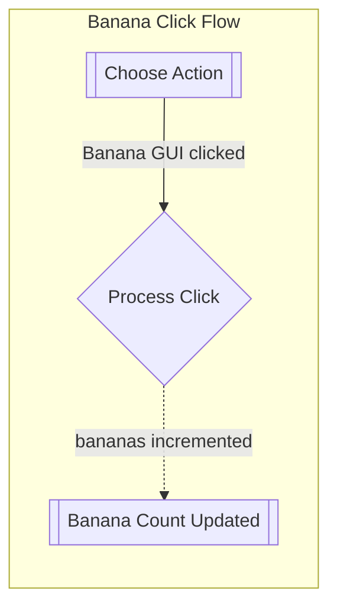
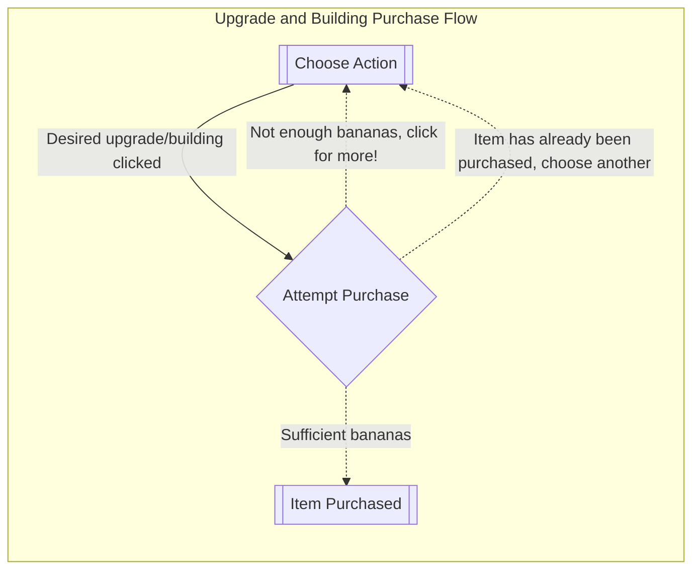
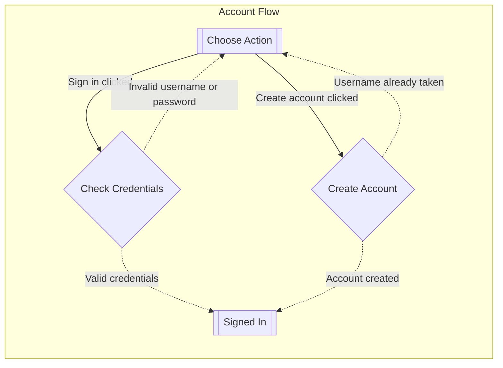

# Flows of interaction

**Banana Click Flow:**

**Upgrade/Building Purchase Flow:**

**Account Flow**:

# Changes

* Seperate flows into two diagrams.
  * one for the purchase and one for clicking
* Added account flow to demonstrate the flows of interaction for creating an account and signing in.
* updated purchase flow to include buildings (essentially the exact same flow)

