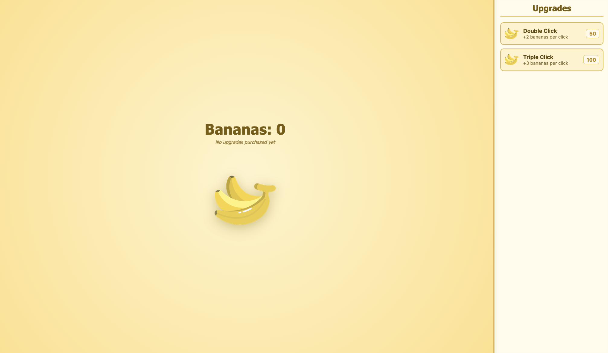
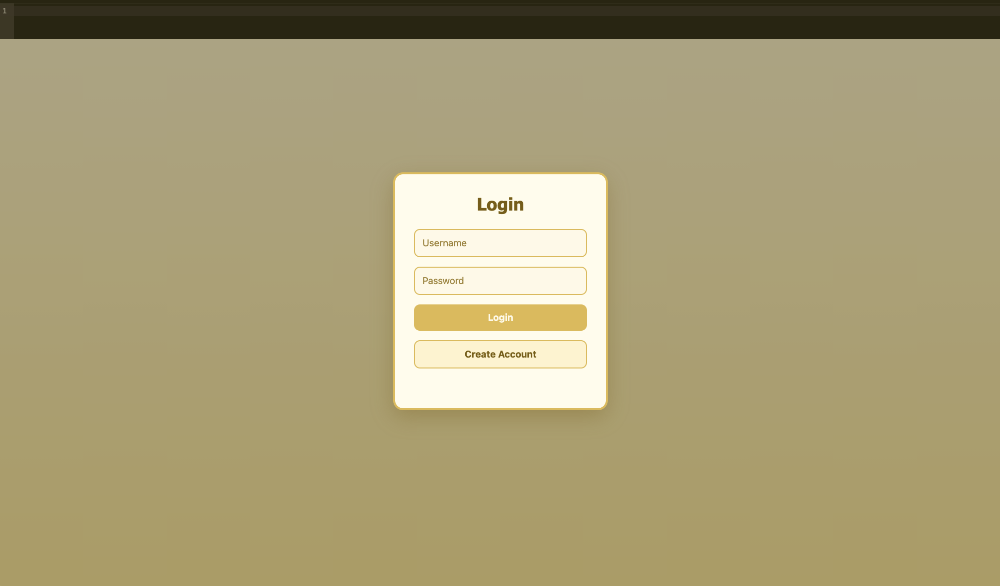
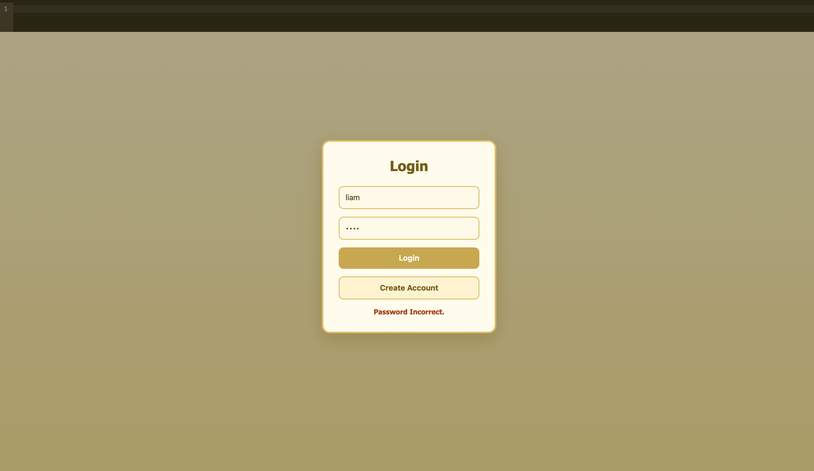
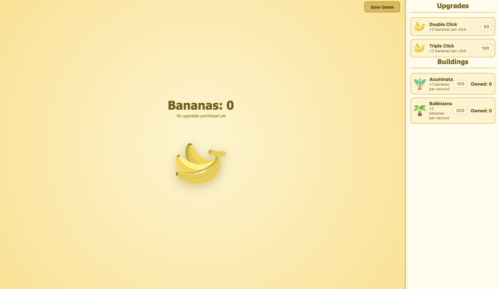
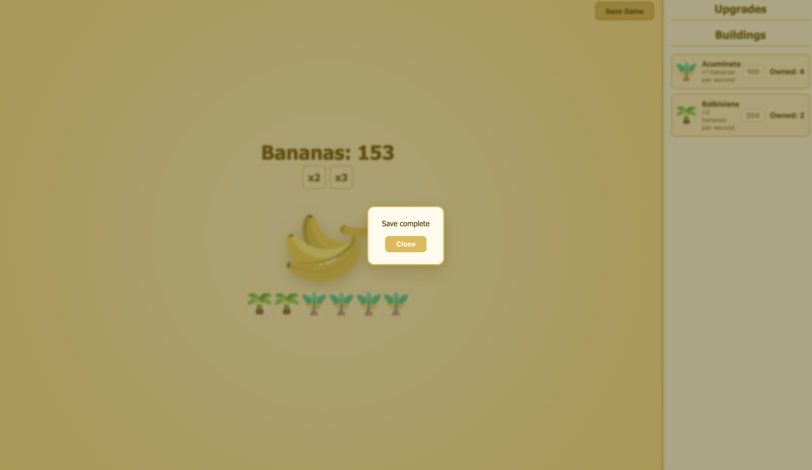

# Phase 1

Here's my entire UI for phase 1:

## Phase 1 visibility

* My phase-1 implementation had a high amount of visibility for the following reasons:
  * :+1: Possible actions are alwasy visible and no UI is hidden from the user and any times.
  * :+1: Actions that are somtimes possbile give visual feedback to the user informing them of what *is* possible.
  * :+1: State is shown to the user indicating what items that have purchased under the banana count in the center of the screen so the user is always aware of the state of the application.

## Phase 1 feedback

* My initial implementation of this UI had adequate feedback:
  * :+1:? There is no user input at this point so nothing to give feedback on there.
  * :+1: Purchasing upgrades either informs the user they do not have enough bananas or purchases the upgrade and displays it under the count.
  * :+1: Error messages are clear and inform the user what went wrong.

## Phase 1 consistency

* My initial had good consistency:
  * :+1: All buttons consistently use the same icons to describe their action. Upgrades both share banana icons. and a same name, desc, price layout.
  * :+1: Purchasing both upgrades flows the same way, banana button works and the user would suspect.

# Phase 2 

Here are the major new parts of my interface for phase 2:

## Changes from phase 1

* Added buildings section to the list on the left hand side.
* Added save button top right to save the game, popping up when the game is saved to inform the user.
* Added login screen with two buttons, one for registering and one for logging in.

## Phase 2 visibility

* :+1: All possible actions remain visibile at all times and message to the user when they have done something impossible are still present.
* :+1: Impossible actions like purchasing upgrades the user already has, are impossible and they disappear from the UI.
* :+1: The user is always aware of what state the applcation is in (login UI for the login screen and banana button with shop for main game UI).

## Phase 2 feedback

* :-1: Saving the game takes a long time and doesnt inform the user when its started or in process.
* :-1: When entering log in inforation you must press login before getting any feedback, instead of while its being typed.
* :+1: The system does inform the user of the results of an operation (saving shows save complete, purchasig upgrade displays an icon, purchasing building show building icon.)

## Phase 2 consistency

* :+1: The new login UI keeps the consistency from the game screen (colors, verbs, etc).
* :-1:? Error message appear as red text in the login box instead of popups in the game screen, though the seperation between in game and logging in could keep this clear. (and abstract consistency with how a login screen should behave).

## How I might change my UI

* I would probably add some kind of spinner or progress indicator for when
  saving is in progress.
* Add updating error messages for the log in window when the user inputs invalid username or password before clicking login.
* Maybe change login error messages to popups instead, though the current design still flows well.
